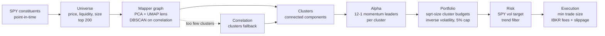
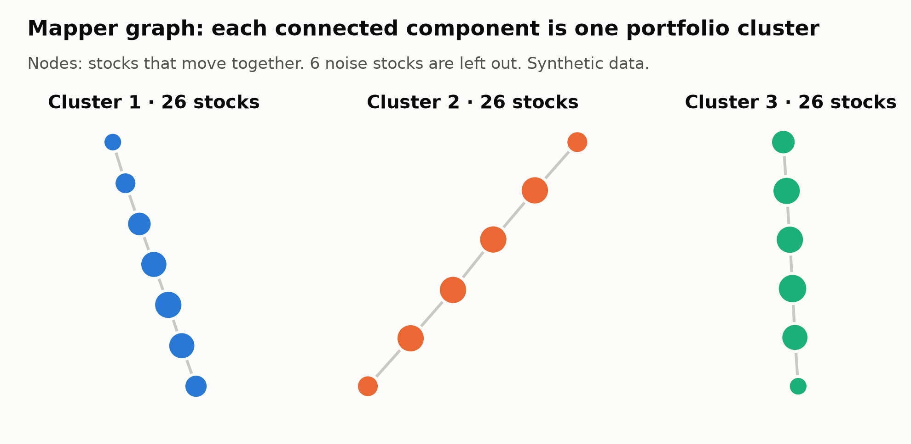
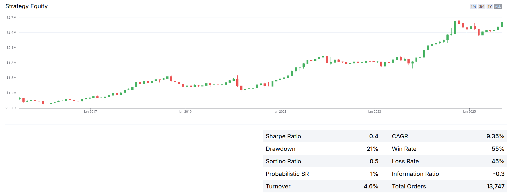

# topological-alpha

[](https://github.com/Amadeus-22/topological-alpha/actions/workflows/ci.yml)
[](LICENSE)
[](pyproject.toml)
[](https://github.com/QuantConnect/Lean)

An S&P 500 long-only strategy for QuantConnect LEAN that clusters stocks with the Mapper algorithm (topological data analysis) and holds the momentum leaders of each cluster, so the portfolio follows strong names without concentrating in one group of correlated stocks.

**Status:** research code, backtested only. One cloud backtest is published (see [Results](#results)); it predates the latest execution fix, and the like-for-like comparison against the two baselines is pending.

## Why

QuantConnect's research article [Portfolio Construction Using Topological Data Analysis](https://www.quantconnect.com/research/18987/portfolio-construction-using-topological-data-analysis/) uses Mapper clusters to diversify and holds every clustered name. This project keeps the same Mapper construction but uses the clusters as a **diversification constraint on a momentum selection**: each cluster contributes only its strongest names.

## How it works



| LEAN framework model | Rule |
| --- | --- |
| **Universe** | SPY constituents with price > $10, daily dollar volume > $25M, market cap > $10B; the 200 most liquid, refreshed monthly. |
| **Alpha** | Monthly Mapper graph on 150 days of log returns (lens: PCA to 80% variance, then 1-d UMAP; DBSCAN on correlation distance per cover interval). Each connected component is a cluster; DBSCAN noise is left out. In each cluster, the top 25% by 12-1 momentum per unit of volatility get an Up insight, positive scores only. Fewer than 3 Mapper clusters falls back to correlation clusters. |
| **Portfolio construction** | Cluster budget proportional to the square root of cluster size; inverse-volatility weights inside the cluster; 5% cap per name. Rebalances only when insights change. |
| **Risk management** | Gross exposure scaled to a 15% volatility target on SPY (63-day realised vol), halved when SPY is below its 200-day average. Recomputed weekly, in steps of 0.25. |
| **Execution** | Market orders. Orders under 0.5% of equity are skipped when they add exposure; reductions and closes always go through. Interactive Brokers fee model plus 5 bps constant slippage. |

Every threshold is a parameter in [`config.json`](TopologicalAlpha/config.json) and can be changed from the QuantConnect parameters panel.

<picture>
  <source media="(prefers-color-scheme: dark)" srcset="docs/mapper-graph-dark.png">
  
</picture>

*Mapper graph on synthetic data (3 sectors of 26 stocks plus 6 noise-only stocks), built by the same `core.mapper_graph` the strategy uses ([`scripts/plot_mapper.py`](scripts/plot_mapper.py)).*

## Design decisions

- **Pure, testable core.** The framework models only fetch data and call [`core.py`](TopologicalAlpha/core.py). Mapper, clustering, momentum scoring, weighting, the regime scale and the trade filter are pure functions tested with pytest, without LEAN.
- **Fail loudly.** Library availability is checked once at start-up and there are no blanket `try/except` blocks, so a broken Mapper run surfaces instead of silently changing the strategy.
- **Turnover by design.** Rebalance only on insight changes, risk scale in discrete weekly steps, skip trades that change nothing material.
- **Costs in every run.** IBKR fees and constant slippage in the strategy and in both baselines.
- **One source, two deliveries.** The modules are the source of truth; [`scripts/bundle.py`](scripts/bundle.py) builds a single `main.py` for the QuantConnect web editor, and CI type-checks that file with strict mypy flags against `quantconnect-stubs`.

## Project layout

```
TopologicalAlpha/              LEAN project
  main.py                      wires the five models, brokerage and costs
  universe.py                  universe selection
  alpha.py                     Mapper clusters and momentum selection
  portfolio.py                 portfolio construction
  risk.py                      risk management
  execution.py                 execution
  core.py                      pure functions (tested)
  config.json                  parameters
baselines/
  spy_buy_and_hold.py          SPY buy and hold, same period, cash and costs
  qc_topological_original.py   the original QuantConnect strategy, same run settings
scripts/
  bundle.py                    single-file build for the QuantConnect editor
  plot_mapper.py               the Mapper figure above
tests/test_core.py             pytest for core.py
.github/workflows/ci.yml       ruff, pytest, bundle + mypy; optional cloud backtest
```

## Run the tests locally

Requires Python 3.11+ (CI uses 3.11).

```bash
make setup    # .venv with research, dev and figure dependencies
make test     # pytest: 10 tests on core.py
make lint     # ruff
make bundle   # build dist/main.py and type-check it against the LEAN stubs
```

## Backtest on QuantConnect

- **Web editor.** Create a Python project and paste the single-file build into `main.py`. Get it from the `main-py` artifact of the latest CI run, or build it with `make bundle`. Alternatively, copy the seven files of `TopologicalAlpha/` with the same names.
- **lean-cli.** From a `lean init` workspace that contains `TopologicalAlpha/`:

  ```bash
  make backtest   # push and run a cloud backtest named after the commit
  make optimize   # cloud parameter optimisation
  ```

- **CI.** Run the workflow manually with `backtest: true` to push the commit and run a cloud backtest (needs `QC_USER_ID`, `QC_API_TOKEN` and `QC_ORGANIZATION` repository secrets).

The baselines in `baselines/` run the same way as separate QuantConnect projects.

## Results

One QuantConnect cloud backtest, 2015-01-01 to 2025-09-30, $1,000,000, daily data, IBKR fees and 5 bps slippage: [public report](https://www.quantconnect.cloud/backtest/55a96f5a00e62b19d8770c6bde1fa15c/?theme=chrome).

[](https://www.quantconnect.cloud/backtest/55a96f5a00e62b19d8770c6bde1fa15c/?theme=chrome)

| CAGR | Sharpe | Sortino | Max drawdown | Information ratio | Turnover | Orders |
| --- | --- | --- | --- | --- | --- | --- |
| 9.35% | 0.40 | 0.50 | 21% | -0.30 | 4.6% | 13,747 |

- The strategy does not beat SPY on a risk-adjusted basis (information ratio -0.30). The risk overlay keeps the book below full exposure for long stretches, which limits drawdowns and also costs return in strong markets.
- This run predates commit `0c3e4af`, which fixed the execution model skipping small trims while buys went through; that bug let the long ratio drift above 1.0. The current code has not been re-backtested yet.

## Limitations and next steps

- Re-run the current code and compare it like for like with both baselines (same period, cash and costs).
- Ablation: do Mapper clusters add value over plain correlation clusters with the same selection, sizing and costs?
- Robustness: walk-forward and parameter-stability checks on `history_lookback`, `select_fraction` and `target_vol`.
- Costs are a fee schedule plus constant slippage; there is no market-impact model.
- Live mode switches to minute data and uses the IBKR brokerage model, but the strategy has only been backtested.

## Credits

The Mapper construction (PCA + UMAP lens, DBSCAN on correlation distance) and the idea of building a portfolio from its connected components come from Louis Szeto's QuantConnect research article linked above. The original strategy is reproduced in [`baselines/qc_topological_original.py`](baselines/qc_topological_original.py) for comparison.

## Disclaimer

Research code. Backtest results do not indicate future performance, and nothing here is investment advice.

## License

[Apache-2.0](LICENSE), the same license as LEAN.
