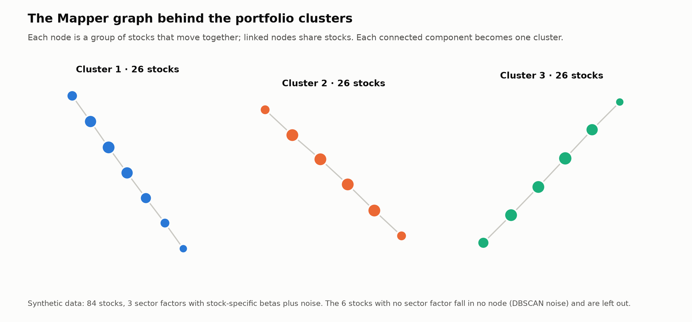
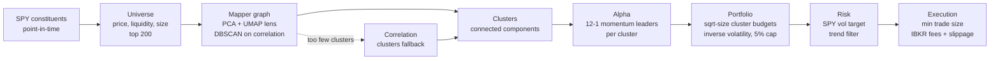
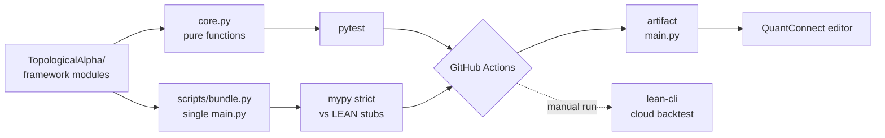

# topological-alpha

[](https://github.com/Amadeus-22/topological-alpha/actions/workflows/ci.yml)
[](LICENSE)
[](pyproject.toml)
[](https://github.com/QuantConnect/Lean)

**A systematic S&P 500 strategy for QuantConnect LEAN.** It groups stocks with the Mapper algorithm from topological data analysis and holds the momentum leaders of each group, with risk and cost controls on top.

The strategy is built on LEAN's Algorithm Framework. The logic is unit-tested, and CI type-checks the project with the same rules the QuantConnect editor enforces.

<picture>
  <source media="(prefers-color-scheme: dark)" srcset="docs/mapper-graph-dark.png">
  
</picture>

## Why

QuantConnect's research article [Portfolio Construction Using Topological Data Analysis](https://www.quantconnect.com/research/18987/portfolio-construction-using-topological-data-analysis/) uses Mapper to diversify across groups of stocks that move together, and it holds every clustered name.

In a public port, that approach trailed SPY over 2021-2026, with CAGR of 10.8% vs 12.2% and Sharpe of 0.33 vs 0.40, and it traded about 17 times more. Diversification alone does not create return.

This project keeps the same Mapper construction but treats the clusters as a **diversification constraint on a momentum selection**. Each cluster contributes its strongest names, so the portfolio holds leaders without concentrating in one corner of the market.

## How it works



| Framework model | Rule |
| --- | --- |
| **Universe** | SPY's point-in-time constituents with price above $10, daily dollar volume above $25M and market cap above $10B. The 200 most liquid, refreshed monthly. |
| **Alpha** | Once a month, a Mapper graph on 150 days of log returns. The lens is PCA (80% of variance) followed by a 1-d UMAP. DBSCAN on correlation distance clusters each cover interval, and each connected component is a cluster. Names DBSCAN marks as noise are left out. Inside each cluster, the top 25% by 12-1 month momentum per unit of volatility get an Up insight, positive scores only. If Mapper yields fewer than 3 clusters, average-linkage correlation clusters are used instead. |
| **Portfolio construction** | Each cluster's budget grows with the square root of its size, and weights are inverse volatility within the cluster, capped at 5% per name. The portfolio rebalances only when insights change. |
| **Risk management** | Gross exposure follows a 15% volatility target on SPY (63-day realised volatility) and is halved when SPY is below its 200-day average. It is evaluated weekly, in steps of 0.25, so noise does not resize the book. |
| **Execution** | Market orders, skipping adjustments smaller than 0.5% of equity, with the Interactive Brokers fee model and 5 bps slippage on every fill. |

All thresholds are parameters (see [`config.json`](TopologicalAlpha/config.json)) and can be changed from the QuantConnect parameters panel without touching code.

## Results

QuantConnect cloud backtest, 2015-01-01 to 2025-09-30, $1,000,000, daily data.

| Metric | Initial version |
| --- | --- |
| CAGR | 9.17% |
| Sharpe ratio | 0.44 |
| Max drawdown | 18.2% |
| Annual volatility | 10.1% |
| Beta / alpha | 0.51 / 0.004 |
| Information ratio | -0.35 |
| Orders / fees | 16,593 / $29,649 |

**What this shows.** Compared with SPY, the initial version carried about half the market risk:
- half the beta;
- lower volatility;
- a much smaller drawdown than SPY's 2020 fall.

It did not produce meaningful alpha, and it traded too much.

**What changed since.** The risk model was the main source of turnover. It now steps exposure weekly instead of resizing the book on daily volatility moves, and the minimum trade size went from 0.25% to 0.5% of equity. On the local smoke test, orders fell by a third.

**Next update.** The current version will be compared like for like against SPY buy-and-hold and the original QuantConnect strategy: same period, cash and costs. All three algorithms are in this repository.

## Engineering



- **Testable core.** The framework models only fetch data and call [`core.py`](TopologicalAlpha/core.py). Mapper, clustering, scoring, sizing and the regime scale are pure functions covered by pytest, so they run without LEAN.
- **No silent failures.** Library availability is checked once, and there are no blanket `try/except` blocks. A failing Mapper run surfaces instead of quietly changing the strategy.
- **Turnover by design.** Rebalancing happens only on insight changes, the risk scale moves in discrete steps, and execution skips trades that change nothing material.
- **Realistic costs.** Interactive Brokers fees and constant slippage on every fill, in the strategy and in both baselines.
- **One source, two deliveries.** The modules are the source of truth. [`scripts/bundle.py`](scripts/bundle.py) builds a single `main.py` for the QuantConnect editor, and CI type-checks that build against `quantconnect-stubs` with the editor's strict rules.

## Project layout

```
TopologicalAlpha/          LEAN project
  main.py                  wires the five models, brokerage and costs
  universe.py              universe selection
  alpha.py                 Mapper clusters and momentum selection
  portfolio.py             portfolio construction
  risk.py                  risk management
  execution.py             execution
  core.py                  pure functions (tested)
  config.json              parameters
baselines/
  spy_buy_and_hold.py      SPY buy and hold, same period, cash and costs
  qc_topological_original.py  the original QuantConnect strategy, same run settings
scripts/
  bundle.py                single-file build for the QuantConnect editor
  plot_mapper.py           the figure above
tests/                     pytest for core.py
```

## Quick start

**On QuantConnect.** Create a Python project and paste the single-file build into its `main.py`. You can download it from the latest CI run's `main-py` artifact, or build it with `make bundle`. Alternatively, create the seven files of `TopologicalAlpha/` with the same names.

**With lean-cli.** From a `lean init` workspace that contains `TopologicalAlpha/`:

```bash
make backtest    # push and run a cloud backtest named after the commit
make optimize    # cloud parameter optimisation
```

**Locally.**

```bash
make setup       # virtualenv with the research and dev dependencies
make test        # pytest
make lint        # ruff
make bundle      # build dist/main.py and type-check it against the LEAN stubs
make figures     # regenerate docs/mapper-graph-{light,dark}.png
```

## Limitations and next steps

- **Ablation.** Measure whether the Mapper clusters add value over plain correlation clusters, with the same selection, sizing and costs.
- **Robustness.** Walk-forward and parameter-stability checks on `history_lookback`, `select_fraction` and `target_vol`.
- **Costs.** The cost model is a fee schedule plus constant slippage, with no market-impact model.
- **Live trading.** The algorithm switches to minute data in live mode and uses the Interactive Brokers brokerage model, but it has only been backtested.

## Credits

The Mapper construction (PCA + UMAP lens, DBSCAN on correlation distance) and the idea of building a portfolio from its connected components come from Louis Szeto's QuantConnect research article linked above. His original code is reproduced in [`baselines/`](baselines/qc_topological_original.py) for comparison.

## Disclaimer

This is research code. Backtest results are not indicative of future performance, and nothing here is investment advice.

## License

[Apache-2.0](LICENSE), the same license as LEAN.
